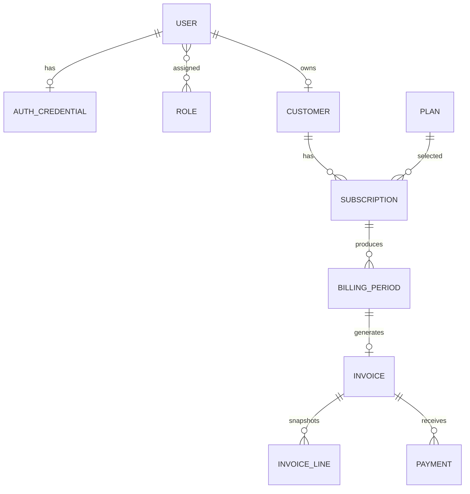

# Database foundation

Products, variants and attributes are normalized. Plans own billing frequency and select product/add-on rows; plan price is the subscription base price, while line price snapshots provide the billable record. The unresolved formula is whether a selected plan product's price replaces or supplements plan price; Phase 1 needs an approved formula before invoice generation.

Billing periods are unique by subscription plus start/end dates, avoiding customer/plan/month collisions. Invoices snapshot mutable billing details. Decimal values are PostgreSQL `NUMERIC`; API money will be decimal strings rounded half-up to two places. Foreign keys use restrictive deletion so financial history survives. `version` fields support future conflict detection.

The tax seed is an 18% tax-exclusive project default, not full GST compliance. Discount selection needs approval; proposed deterministic rule is highest monetary reduction, then earliest start, then code, with only one invoice discount.
